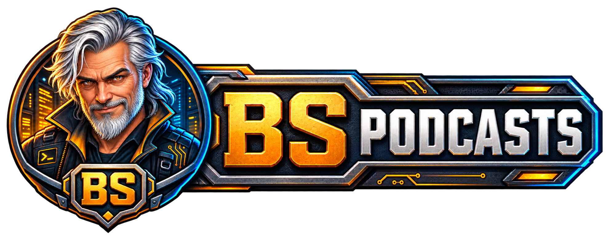
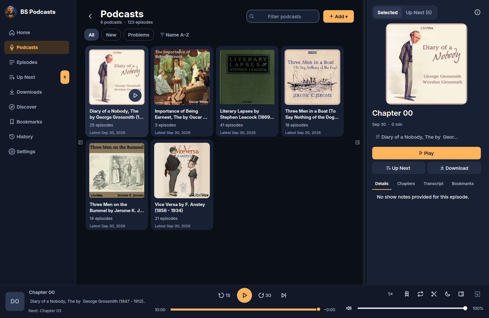
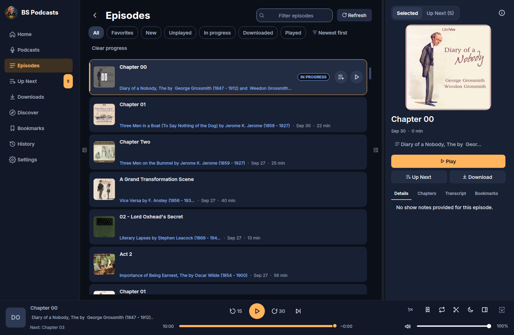

  

A desktop player for the podcasts you already have.

Listen, download and organize your podcasts on **Windows, macOS and Linux**.
Keep your subscriptions, episode details and listening queue together, with
playback controls always within reach.

**9.31:** Improved persistent caching, streaming stability and GUI responsiveness,
with compact episode rows and selection details shown in the side panel.

## Screenshots

### Your podcast library and Up Next

Browse your shows while keeping the next episodes in view.

### Episodes, details and playback

Pick up where you left off, browse a show's episodes and keep the details beside
your player.

*Screenshots show an isolated example library using real comedy/humor audio
feeds and public-domain cover art from [LibriVox](https://librivox.org/pages/public-domain/).*

## Features

- **Your subscriptions:** add podcast feeds or import and export OPML.
- **Listen your way:** stream episodes or download them for offline listening.
- **Keep things organized:** Up Next and favorites.
- **Stay in control:** playback speed, skip controls and a sleep timer.
- **Find your place:** listening history, saved progress and bookmarks.
- **Go deeper:** chapters and transcripts when the podcast provides them.
- **Bring your own audio:** import local audio files with their metadata.
- **Discover something new:** search podcast directories from inside the app.

## Download and run

Choose the latest package for your operating system from the repository's
**Releases** page.

| Platform | Getting started |
| --- | --- |
| Windows x64 | Extract the ZIP and open `BS Podcasts.exe`. Keep the complete `BS Podcasts` folder together, including `_internal`. |
| macOS — Apple Silicon | Extract the ZIP and open `BS Podcasts.app`. Requires macOS 14 or later. |
| Linux x86-64 | Make the `.AppImage` executable, then open it. Python and Qt are included; no Python setup is required. This build requires glibc 2.43 or newer. |

The Windows package is unsigned. The macOS package is not notarized, so your
operating system may display a warning. Only run packages you trust. Close the
app before replacing it during an update.

## Your library

Your subscriptions, settings and listening progress are stored locally. You can
choose where downloaded episodes are saved. Keep a backup of your library and
preserve your data when updating the app.

On Linux, the AppImage normally stores your library under
`~/.local/share/bs-podcasts` and artwork under `~/.cache/bs-podcasts`, respecting
XDG directory overrides. Replacing the AppImage leaves those folders alone.
If an earlier package's `BS-Podcasts-data/library.db` is beside the AppImage,
it reuses that library when no standard-profile library exists; it does not move
or delete it. You can explicitly choose an existing library folder with
`BS_PODCASTS_DATA_DIR`.

Finding shows, refreshing feeds, loading artwork and streaming use the network.
Downloaded episodes can be played offline.

## Reporting a problem

After the problem occurs, open **Settings → Diagnostics → Export diagnostics**.
Review the preview and exclude any log you do not want to share, then save the ZIP.
It contains build information and redacted logs—not your library, downloads or settings.

Open a ticket in this repository's **Issues** tab, describe what
you did, what you expected, what happened and roughly when it happened, then attach
the ZIP. The logs are already inside; you do not need to attach the original logs.
Nothing is uploaded automatically. Public issues and attachments are public, and
automatic redaction can miss personal text, so review before attaching.

If logging was off, enable **Settings → Diagnostics → Write a private diagnostic log file**,
reproduce the problem if safe, and export again. Build identification is also shown in **About**.

## Copyright

BS Podcasts — **all rights reserved**. Third-party software and fonts retain
their own licenses. Third-party notices are included in each application package.
